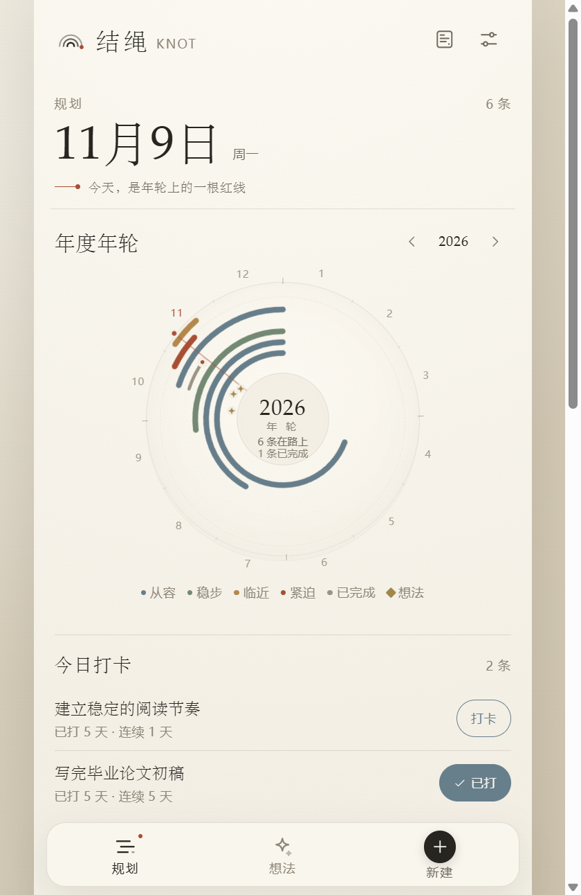

# 结绳 KNOT 桌面版

Windows x64 桌面应用，基于 Electron 45 + 本项目的 Vite 构建。界面、数据模型和本地优先逻辑与 Web / Android 版本一致。

`knot.exe` 是一个 64 位兼容启动器，它会以 `--no-sandbox` 启动同一目录里的 `knot-core.exe`。这样可以在 Chromium 沙箱受限的 Windows 环境里正常打开；应用本身只加载本地 `dist`，禁用 Node 集成，开启 contextIsolation，并阻止远程导航。

## 交付物

| 文件 | 大小 | 说明 |
|---|---:|---|
| [`release-desktop/knot-desktop-2.2.2-portable.exe`](release-desktop/knot-desktop-2.2.2-portable.exe) | 110,641,064 字节 | 单文件便携版，双击运行 |
| [`release-desktop/knot-desktop-2.2.2-x64.zip`](release-desktop/knot-desktop-2.2.2-x64.zip) | 153,598,175 字节 | 解压后运行 `knot.exe` |
| [`release-desktop/SHA256SUMS-desktop.txt`](release-desktop/SHA256SUMS-desktop.txt) | — | 校验信息 |

```text
portable.exe  02B74E764A558B6A3A62A0ACB3AA37849CBAF106091358EC395960214C40C08E
x64.zip       D045EDA48C651BF360504C7690BB1F00E539A964405E9E79195D5AFEA7E176D1
```

> 桌面包没有代码签名。Windows SmartScreen 可能会提示“未知发布者”，需要选择“更多信息 → 仍要运行”。这不是病毒提示，但请只运行自己确认过来源的包。

## 运行

### 便携版

1. 双击 `knot-desktop-2.2.2-portable.exe`
2. 首次启动会解压到临时目录，可能比 zip 版慢几秒
3. 数据保存在当前 Windows 用户的应用数据目录

### 解压版

1. 解压 `knot-desktop-2.2.2-x64.zip`
2. 进入解压目录，双击 `knot.exe`
3. 可以把整个目录移动到固定位置

如果便携版被安全软件拦截，优先使用 zip 解压版。

## 如果双击没有反应

1. 确认 zip 已经完整解压，不要直接在压缩包里双击 `knot.exe`
2. 首次启动 portable 版需要解压到临时目录，等待 5–10 秒
3. 查看启动日志：

   ```text
   %TEMP%\knot-desktop.log
   ```

   如果日志中存在 `userData failed`，说明数据目录被安全策略拒绝；应用会自动回退到临时目录。
4. 如果 Windows SmartScreen 拦截，选择「更多信息 → 仍要运行」
5. 如果仍然没有窗口，把 `%TEMP%\knot-desktop.log` 最后几行发回来

## 桌面版特性

- 独立窗口，不依赖浏览器标签页
- 应用图标、标题和窗口背景保持结绳风格
- 设置页显示「桌面版 · Windows」
- 不显示浏览器安装引导
- 系统浏览器打开 GitHub 链接
- 数据位置：
  - 便携版：exe 同目录的 `KnotData`
  - 解压版：`%APPDATA%\Knot`
  - 受限环境自动回退到临时数据目录
- 卸载或清理应用数据会丢失，请用设置里的「导出备份」定期保存 JSON
- 开发者链接：<https://github.com/tujingsushi/knot>



## 数据

桌面版使用 Electron 的持久化 Chromium 存储：

```text
便携版：exe 同目录 / KnotData
解压版：%APPDATA%\Knot
```

规划和想法与 Web 版共用同一套 JSON 结构，因此可以在桌面 / Web / Android 之间互相导入导出。

备份方式：设置 → 导出备份。导出的 JSON 会通过系统下载目录保存。

## 开发

```powershell
npm install
npm run desktop:dev
```

`desktop:dev` 会先构建 `dist`，再启动 Electron。

只构建不运行：

```powershell
npm run desktop:unpacked   # release-desktop/win-unpacked
npm run desktop:pack       # zip
npm run desktop:portable   # portable exe
```

如果 Electron 二进制未安装：

```powershell
npx electron --version
```

## 构建说明

- Electron：45.2.3
- 主进程：`desktop/main.cjs`
- 预加载桥：`desktop/preload.cjs`，只暴露只读平台信息
- 渲染层：`dist/index.html`，与 PWA 共用同一份构建
- 窗口：560 × 860，最小 430 × 680
- `nodeIntegration: false`、`contextIsolation: true`、`sandbox: true`
- 外部链接只允许 http/https，并通过系统默认浏览器打开
- 不注册 Service Worker
- 不使用远程内容

## 验证状态

已完成：

- Electron 开发模式启动
- 打包后的 `knot.exe` 启动并加载 `dist`
- 便携版直接双击启动正常（不附加命令行参数）
- 解压版 `knot.exe` 直接启动正常
- 桌面桥识别 `win32` / Electron 45.2.3
- 设置页显示桌面版、开发者信息和数据说明
- 渲染层控制台无错误

未完成：

- 没有代码签名证书，因此没有消除 SmartScreen 提示

如果需要在 GitHub 上分发，建议把 portable.exe 和 zip 作为 Release 资产上传，而不是提交进 git；仓库已经忽略 `release-desktop/` 与 `*.exe` / `*.zip`。
