# 结绳 KNOT 2.7.0

开发者：**tujingsushi**  
仓库：[github.com/tujingsushi/knot](https://github.com/tujingsushi/knot)

**结绳**是一个本地优先的规划应用：用年轮、单条时间轴、子目标、每日打卡和「想法」页，把想做的事放回真实的时间里。

应用原名「三程」，2.0.0 起更名为「结绳」，英文名为 **KNOT**。2.1.0 把原来的总览页和规划页合并成一个「规划」页：日期、年轮、今日打卡、筛选和时间轴都在同一页。2.2.0 新增「想法」页：不急着安排时间的事可以先记下来，并以金色小点出现在年轮上。2.2.1 让已完成的规划也留在年轮上，以灰色细弧和完成结呈现。2.4.0 为想法补上已实现与归档状态，并把年轮上的想法改为按月聚合，避免重叠。2.5.0 增加五种主题。2.5.6 关闭 Android captureInput，修复中文输入法。2.7.0 精简页面结构与说明文字。名字来自「结绳记事」，也对应应用里的完成打结、今天红线和每一次打卡。启动时只显示一页随机名言。

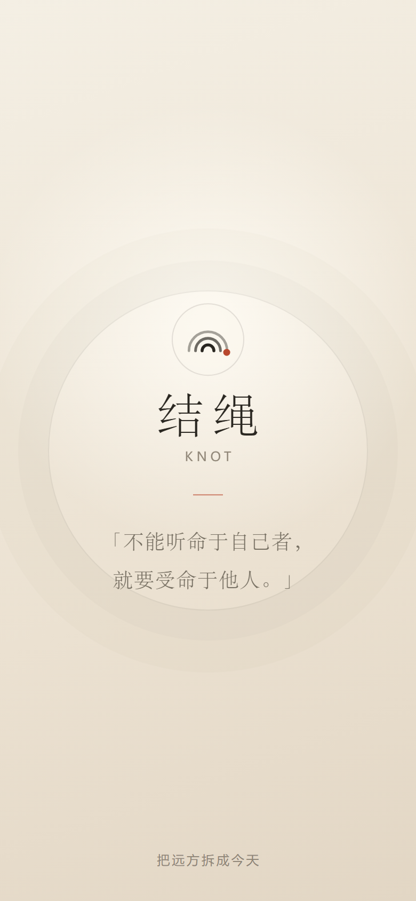

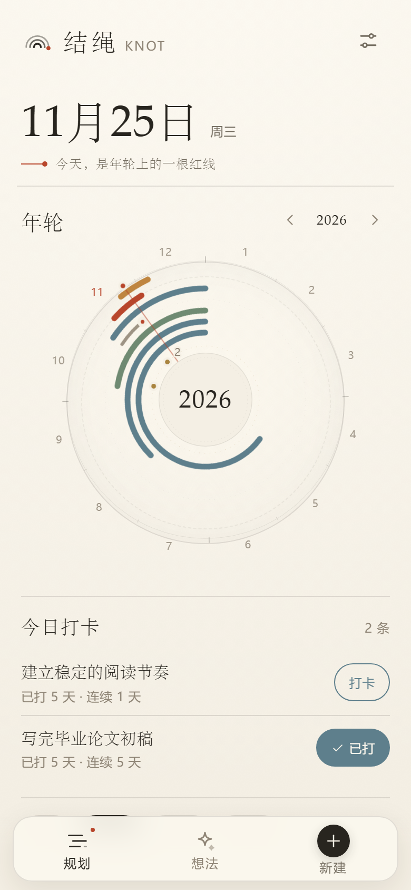

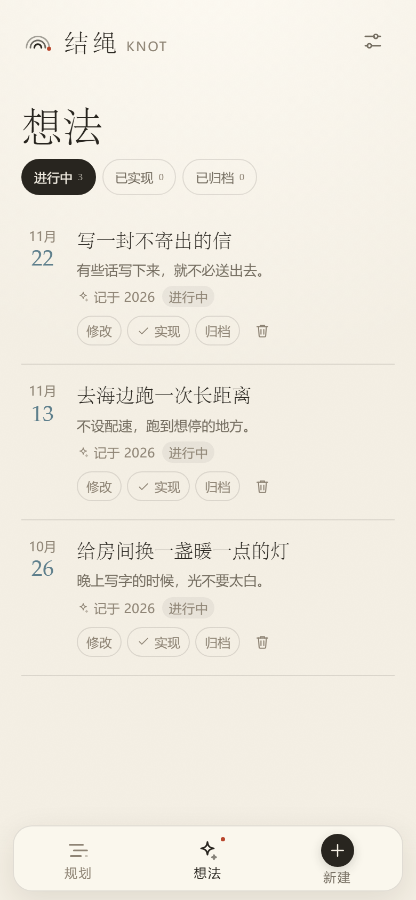

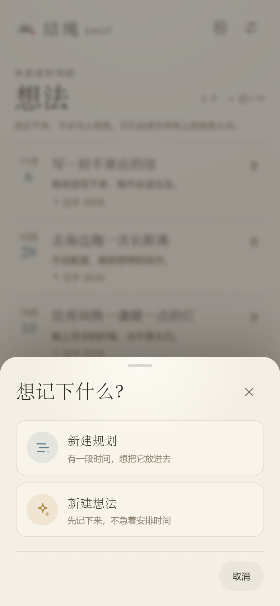

## 开发者信息

- 开发者：**tujingsushi**
- 仓库：<https://github.com/tujingsushi/knot>
- 设置页底部会显示开发者和可点击的仓库地址
- `package.json`、网页 `author` 元信息和 Android `strings.xml` 都写入了开发者信息


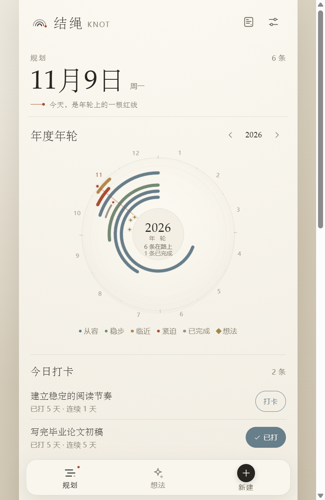

## 交付物

| 文件 | 说明 |
|---|---|
| [`release/knot-2.7.0.apk`](release/knot-2.7.0.apk) | 已签名 Release APK，约 3.5 MB，Android 7.0+ |
| [`release/knot-web-2.7.0.zip`](release/knot-web-2.7.0.zip) | 可部署到 HTTPS 的 PWA 构建包 |
| [`release-desktop/knot-desktop-2.2.2-portable.exe`](release-desktop/knot-desktop-2.2.2-portable.exe) | Windows x64 单文件便携版 |
| [`release-desktop/knot-desktop-2.2.2-x64.zip`](release-desktop/knot-desktop-2.2.2-x64.zip) | Windows x64 解压版 |
| [`ios/`](ios/) | Capacitor iOS 原生工程（需 macOS/Xcode 编译） |
| [`IOS.md`](IOS.md) | iOS 构建、签名与 App Store 说明 |
| [`PRIVACY.md`](PRIVACY.md) | App Store 隐私政策 |
| [`DESKTOP.md`](DESKTOP.md) | 桌面版安装、数据与构建说明 |
| [`APK-INSTALL.md`](APK-INSTALL.md) | HarmonyOS 7 / 卓易通安装说明与风险 |
| [`screenshots/`](screenshots/) | 开屏、规划、想法、桌面版、详情等截图 |

APK 校验信息：

```text
应用名：结绳
包名：com.sancheng.app
版本：2.7.0 (versionCode 41)
compileSdk：36
targetSdk：34
minSdk：24
签名：v2，CN=SanCheng
大小：3,526,154 字节
SHA-256：D7A4ABB6536F6BA46CE17CFDE5F34C5423197E4B99CF2CB312AE79A739D87488
```

> **重要：** HarmonyOS 7 是纯血鸿蒙，系统本身不能安装 Android APK。这个 APK 只能通过 **卓易通等 Android 兼容层**运行，不是鸿蒙原生 HAP。兼容层是否支持该 APK，必须在你手机上实际验证。

## 桌面版

Windows x64 桌面版基于 Electron 45，与 Web 版共用同一份界面和数据模型。

- 便携版：`release-desktop/knot-desktop-2.2.2-portable.exe`，110,641,064 字节
- 解压版：`release-desktop/knot-desktop-2.2.2-x64.zip`，153,598,175 字节
- 便携版 SHA-256：`02B74E764A558B6A3A62A0ACB3AA37849CBAF106091358EC395960214C40C08E`
- 解压版 SHA-256：`D045EDA48C651BF360504C7690BB1F00E539A964405E9E79195D5AFEA7E176D1`
- 详细说明见 [DESKTOP.md](DESKTOP.md)

`knot.exe` 是兼容启动器，会启动同目录的 `knot-core.exe --no-sandbox`，用于兼容 Chromium 沙箱受限的 Windows。便携版数据在同目录 `KnotData`，解压版在 `%APPDATA%\Knot`。未做代码签名，SmartScreen 可能提示未知发布者。

> 2.7.0 本次只重建了 Android / Web 交付包；上面的 Windows 桌面包仍是 2.2.2，源码已包含最新改动，但桌面包尚未重建。

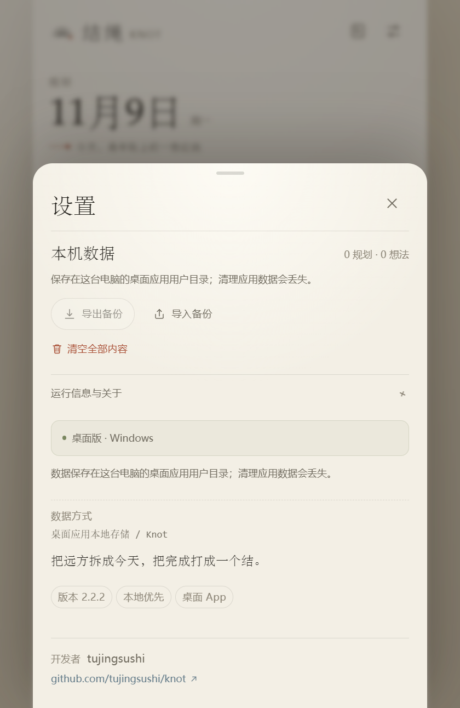

## 主题颜色

设置页新增 5 种主题，只改变颜色，不改变规划、想法和备份数据：

- **纸黄**：原始纸色与黛青
- **青瓷**：青灰纸与松石绿
- **暮蓝**：雾蓝纸与深海蓝
- **胭脂**：暖粉纸与酒红
- **松墨**：浅苔纸与深松绿

主题会保存在本机，重新打开仍沿用；状态栏、导航栏和页面安全区颜色也会跟随。

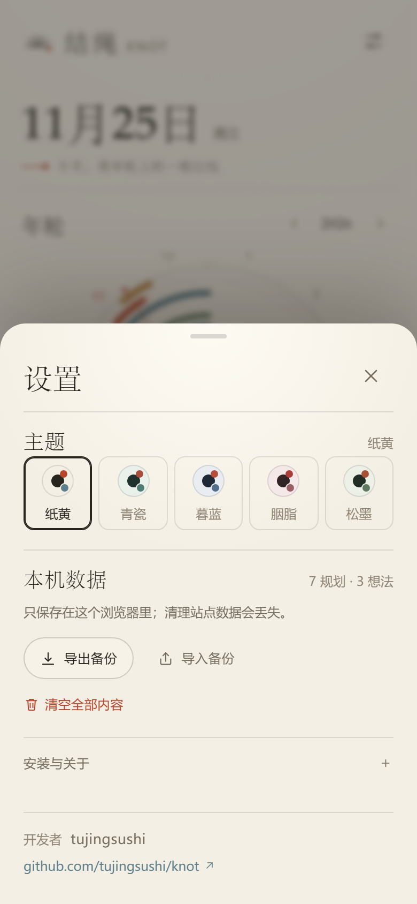

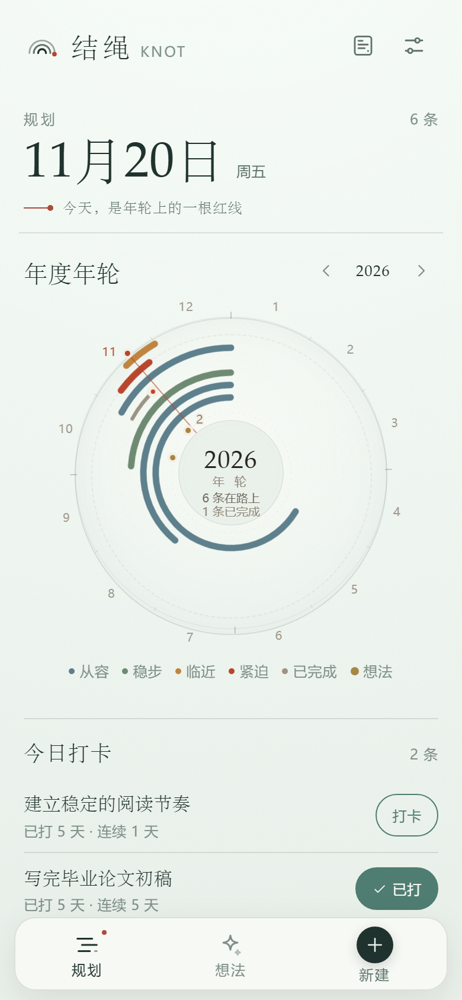

## 年轮

2.7.0 恢复了原来的单年显示：

- 年轮固定显示 1–12 月
- 中心显示选中年份
- 跨年度规划仍按当前年份截取显示，不再把整张年轮扩展成多年
- 年份切换、今天红线和月份刻度保持原来的行为
- 想法仍按月聚合，避免重叠


## 想法状态与年轮

2.4.0 为想法补上了完整的生命周期：

- **进行中**：想法默认状态，会显示在年轮上
- **已实现**：标记实现后在年轮上变成空心金色记号
- **已归档**：从年轮上隐藏，可在「想法 → 已归档」中恢复
- 想法页支持按状态筛选，并显示各状态数量
- 想法可修改标题、备注和日期；卡片上的「修改」按钮和年轮记号都可以打开编辑
- 2.7.0 起编辑页顶部也有「保存」，键盘挡住底部按钮时仍然可以保存
- 2.7.0 关闭 Android `captureInput`，中文输入法改用 WebView 原生输入连接，不再把中间输入追加到末尾
- 2.7.0 标题和补充使用非受控输入，保存时读取输入框当前值
- 2.7.0 修复延迟聚焦标题抢走补充输入焦点的问题
- 2.7.0 避免原生旧快照覆盖本地刚保存的修改
- 年轮不再为每个想法画一颗可能重叠的星，而是**按月份聚合**：每个月一个金色记号，同月多个想法显示数量
- 点击月份记号会打开该月第一条想法进行编辑


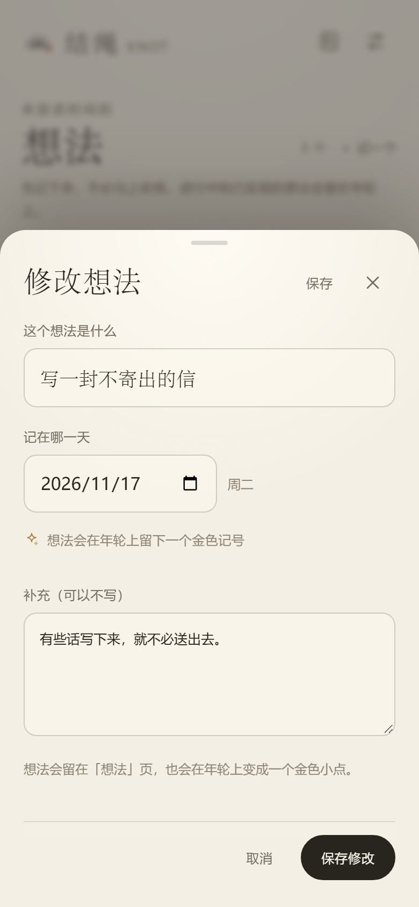

## iOS 版

iOS 原生工程已经生成，位于 [`ios/`](ios/)，使用 Capacitor 8 + Swift Package Manager。

- Bundle ID：`com.sancheng.app`
- 显示名：结绳
- Marketing Version：2.7.0
- 最低系统：iOS 15
- 设备：iPhone，竖屏
- 启动画面：纯纸色，进入后仍是名言页
- 应用图标：1024 × 1024
- 状态栏：浅色背景 + 深色内容
- 隐私政策：[PRIVACY.md](PRIVACY.md)

**Windows 不能编译 IPA。** 必须使用 macOS + Xcode 构建和签名：

```bash
npm install
npm run build
npx cap sync ios
npm run ios:open
```

在 Xcode 中选择 Team 后可直接安装到 iPhone；TestFlight / App Store 需要付费 Apple Developer Program。完整步骤、签名和 App Store 注意事项见 [IOS.md](IOS.md)。

仓库还提供 `.github/workflows/ios-build.yml`，可在 GitHub Actions 的 macOS 上构建 **iOS Simulator** 版本（不需要签名，但不能安装到真机）。

## 更名说明

- 桌面图标名称、应用内字标、PWA 名称、今日一页水印都改为「结绳」
- 英文副标和英文名改为 `KNOT`
- **包名仍是 `com.sancheng.app`**，没有更换
- 存储键、原生数据文件名和备份里的 `app: "sancheng"` 保留，用于兼容旧数据
- 想法使用独立的 `sancheng.ideas.v1` 键，并一起写入原生快照和 JSON 备份
- 因此从「三程」1.3.x 可以直接覆盖升级，规划、子目标、打卡记录都会保留

如果未来改成全新包名，旧 App 无法直接覆盖，需要先导出 JSON，再在新包导入。

## 开屏名言

每次冷启动会从四句名言中随机选一句显示：

1. 不能听命于自己者，就要受命于他人。
2. 每一个不曾起舞的日子，都是对生命的辜负。
3. 对未来真正的慷慨，是把一切献给现在。
4. 对待生命你不妨大胆冒险一点，因为好歹你要失去它。

开屏约 3 秒，轻触可提前进入。名言只用于本地展示，不联网、不统计。

启动时只显示这一页：

- 已移除 Android 启动画面的应用图标（改为透明图标 + 纸色背景）
- 已移除 HTML 启动占位里的「结绳」名称页
- 冷启动从第一帧内容开始就是名言页
- 某些系统在 WebView 加载前仍会有极短的纸色空白帧，但不会再出现图标页或名称页

## 2.7.0 桌面宽屏适配

- 桌面端应用框架最大宽度从 480px 扩展到 1120px
- 规划页改为「左侧年轮 + 右侧打卡/时间轴」双栏
- 想法页改为两列卡片布局
- 设置、规划和想法弹层在桌面端变成居中宽弹窗
- 底部导航在桌面端保持 420px 居中悬浮
- 增加桌面端宽屏布局与横向溢出检查
- 版本升至 2.7.0，versionCode 41

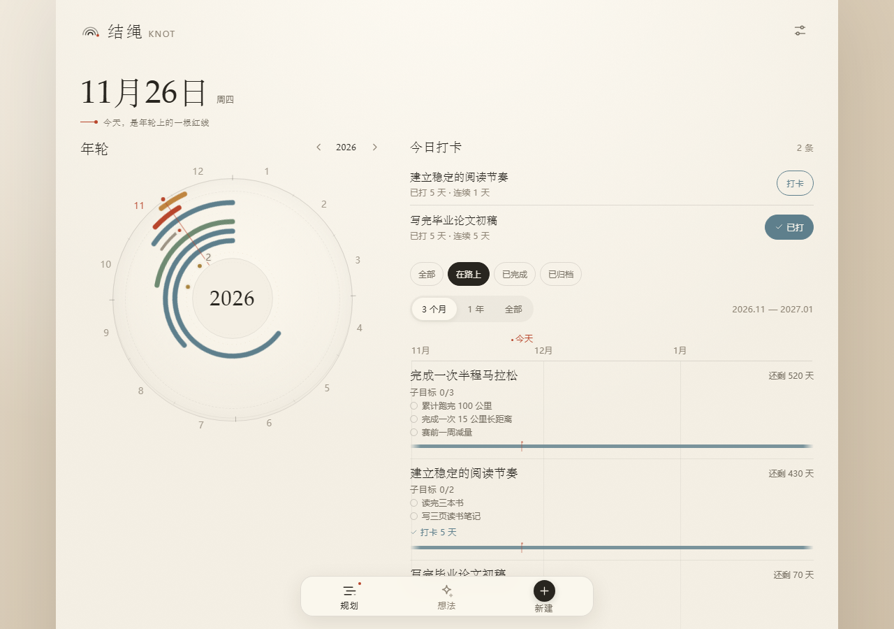

## 2.6.4 移除页面标语

- 删除开屏页底部的「把远方拆成今天」
- 网页标题改为「结绳 KNOT」
- PWA manifest 名称改为「结绳 KNOT」
- 页面 description 移除「把远方拆成今天」
- 版本升至 2.6.4，versionCode 40

## 2.6.3 开屏闪烁修复

- 移除开屏层从透明到不透明的 `splash-in` 淡入动画
- 移除开屏内部内容的 `splash-rise` 淡入和位移
- 开屏从第一帧起就是不透明背景，规划页不会再提前露出
- 保留开屏退出时的淡出动画
- 版本升至 2.6.3，versionCode 39

## 2.6.2 设置与新建页文案精简

- 删除设置页主题下方的「选一种纸色」
- 删除原生 App 设置页的「自动写入 App 私有文件；卸载或清除应用数据会丢失」
- 新建选择页删除「放进一段时间 / 先记下来」，只保留「新建规划 / 新建想法」
- 版本升至 2.6.2，versionCode 38

## 2.6.1 页面结构精简

- 规划页删除日期上方的「规划」眉题和规划条数
- 删除「今日一页」入口、页面和相关导出代码
- 删除年轮下方的颜色图例
- 「年度年轮」标题改为「年轮」
- 年轮中心只保留年份，删除「年轮 / 条数 / 已完成」等小字
- 想法页删除「全部」筛选，默认显示「进行中」
- 想法页删除顶部计数和「记一个」入口
- 版本升至 2.6.1，versionCode 37

## 2.6.0 页面文案精简

- 「想法」页移除眉题和整段说明，只保留标题、数量和筛选
- 想法编辑表单标签缩短为「想法 / 日期 / 补充」
- 移除想法编辑页两段重复的金色记号说明
- 规划表单标题改为「规划名称」，移除每日打卡的整段解释
- 主题说明缩短为「选一种纸色」
- 新建选择页说明缩短为「放进一段时间 / 先记下来」
- 今日一页移除「非实时小组件」说明
- 版本升至 2.6.0，versionCode 36

## 2.5.11 原生键盘高度避让

- 部分 Android edge-to-edge 设备上 `visualViewport` 不会报告键盘高度
- 引入 `@capacitor/keyboard`，监听 `keyboardWillShow` / `keyboardDidShow` / `keyboardWillHide`
- 把原生键盘高度通过 `knot:keyboard` 事件传给所有底部弹层
- 如果布局视口没有因 `adjustResize` 缩小，就使用原生键盘高度抬升弹层
- 键盘变化后再次把当前输入框滚动到可视区域
- 版本升至 2.5.11，versionCode 35

## 2.5.10 键盘避让

- 所有底部弹层监听 `window.visualViewport`，实时计算键盘高度
- 通过 `--keyboard-inset` 把弹层整体抬到键盘上方，并限制最大高度
- 输入框获得焦点后自动滚动到可视区域
- 覆盖 Android 的 `adjustResize`、edge-to-edge 以及 iOS 键盘遮挡场景
- 版本升至 2.5.10，versionCode 34

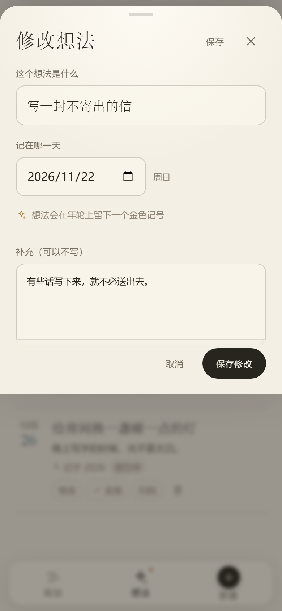

## 2.5.9 主题表面修复

- 开屏名言页的背景改用主题变量，不再固定纸黄
- 底部「规划 / 想法 / 新建」导航卡的底色改用 `--card`
- 年轮中心圆改用 `--paper`
- 输入框和日期框的底色改用 `--card` 的 color-mix，不再固定米白
- 应用在 React 渲染前先应用已保存主题，避免开屏先闪一下纸黄
- 版本升至 2.5.9，versionCode 33

## 2.5.8 EdgeToEdge 系统栏

- 2.5.7 直接设置系统栏颜色在部分 Android 15/16 设备上会被 edge-to-edge 忽略
- 引入 `@capawesome/capacitor-android-edge-to-edge-support`，用原生覆盖层给状态栏和导航栏上色
- 将 Activity 的 `windowBackground` 和 decorView 背景改为透明，避免系统用默认纸黄填充
- 关闭 Capacitor 内置 SystemBars 的 insets 处理，改由 EdgeToEdge 插件处理安全区
- 保留 `ThemeBars` 作为直接设置系统栏和图标样式的回退
- 版本升至 2.5.8，versionCode 32

## 2.5.7 主题状态栏与导航栏

- 新增 Android 原生 `ThemeBars` 插件，同时设置状态栏和导航栏颜色
- 切换主题时立即同步两条系统栏，不再保留默认纸黄
- 关闭 Android 导航栏对比度遮罩，避免颜色被系统改成灰色
- `body` 和 `#root` 的初始背景改用主题 `--paper`，避免安全区露出纸黄
- 版本升至 2.5.7，versionCode 31

## 2.5.6 Android 输入法根因修复

- 根因是 Capacitor 的 `android.captureInput: true`
- 这个选项会让 CapacitorWebView 返回 `BaseInputConnection`，破坏 WebView 原生的中文输入法 composition 和光标处理
- 关闭 `captureInput` 后，中文输入重新使用 WebView 原生 InputConnection
- 移除 2.5.4 / 2.5.5 的 composition 补丁，避免和原生输入法重复处理
- 模态层移除常驻 CSS transform，避免 WebView 的输入法坐标映射偏移
- 版本升至 2.5.6，versionCode 30

## 2.5.5 延迟提交输入法兜底

- 部分 Android WebView 会在 compositionend 之后才真正提交输入法文字
- 曾尝试保留待校正内容和原光标位置，在最终 input 事件或短延迟后再次校正
- 该方案被 2.7.0 的原生 InputConnection 修复取代
- 版本升至 2.5.5，versionCode 29

## 2.5.4 输入法中间插入兜底

- 监听 compositionstart / compositionend，记录输入法开始时的光标位置
- 输入法提交文字后，如果内容被追加到末尾，会按原光标位置重组
- 同时监听 beforeinput / input，在普通插入事件中校正光标和内容
- 标题和补充都使用这套校正
- 版本升至 2.5.4，versionCode 28

## 2.5.3 想法补充光标修复

- 标题和补充改为非受控输入，输入过程中不再由 React 重设整段内容
- 在补充文字中间插入时保持光标位置，不再自动追加到末尾
- 保存仍从输入框读取最新内容
- 版本升至 2.5.3，versionCode 27

## 2.5.2 恢复单年年轮与想法编辑修复

- 年轮恢复固定 1–12 月的单年显示
- 跨年度规划重新按当前年份截取，不再扩成多年视野
- 想法编辑页新增顶部「保存」入口，避免键盘遮挡底部按钮
- 标题输入框按回车可直接保存
- 编辑使用点击时的想法快照，不再依赖列表查找
- 修复延迟聚焦标题抢走补充输入焦点的问题
- 保存时读取输入框当前值
- 原生旧快照不再覆盖本地刚保存的修改
- 版本升至 2.5.2，versionCode 26

## 2.5.0 主题颜色

- 新增纸黄、青瓷、暮蓝、胭脂、松墨 5 种主题
- 主题保存在本机，并同步原生状态栏颜色
- 版本升至 2.5.0，versionCode 24

## 2.4.0 想法状态与年轮重排

- 删除时间螺旋及其切换入口，年轮恢复为唯一时间视图
- 想法新增「进行中 / 已实现 / 已归档」状态
- 想法页新增状态筛选和数量统计
- 想法可修改标题、备注与日期
- 修复已有想法编辑入口：卡片、显式「修改」按钮和年轮记号都能打开编辑
- 年轮上的想法改为按月聚合，同月多个想法显示数量，彻底避免点子重叠
- 已实现想法用空心金色记号表示，归档想法不在年轮显示
- 版本升至 2.4.0，versionCode 23

## 2.2.2 开发者信息与桌面版

- 设置页底部新增「开发者 tujingsushi」
- 新增可点击的仓库地址 `github.com/tujingsushi/knot`
- 网页、PWA 和 Android 包内补充开发者元信息
- 新增 Electron Windows 桌面版：便携 exe、解压 zip
- 桌面版识别自己的运行环境，隐藏浏览器安装引导，显示数据说明
- 不改变应用数据、包名和 Android 签名

## 2.2.1 已完成规划留在年轮上

- 年轮现在同时包含「在路上」和「已完成」的规划，已归档的规划仍不画入
- 已完成规划用一条更细、更淡的灰色弧线表示，不再消失
- 完成的位置保留红色小结
- 年轮中心会同时显示在路上和已完成的数量
- 年轮图例新增灰色的「已完成」
- 已完成规划仍可点击弧线进入详情

## 2.2.0 想法页

- 底部导航新增「想法」，底部「新建」会先让你选择新建规划或新建想法
- 想法只有标题、补充和记录日期，不要求安排开始 / 结束时间
- 想法按日期倒序展示，可以点击编辑、也可以删除
- 每个想法会以金色小点出现在对应年份的年轮上
- 年轮图例新增「想法」；同一天有多个想法时，会在同一角度轻微错开
- 想法和规划分开存储，但共用同一份 JSON 备份和原生快照

## 功能

- **单页规划**：日期、年轮、今日打卡、状态筛选、时间范围、时间轴合并在一个「规划」页
- **主题**：纸黄、青瓷、暮蓝、胭脂、松墨 5 种纸色
- **想法页**：默认显示进行中，支持进行中 / 已实现 / 已归档筛选和日期修改
- **年轮想法**：按月聚合，同月多个想法显示数量，避免重叠
- 规划：标题、起止日期、备注、子目标、每日打卡、状态
- 年轮：固定 1–12 月，显示在路上的规划和已完成规划，按时间紧迫度变色
- 单条时间轴：3 个月 / 1 年 / 全部
- 规划页默认「在路上」，可切换已完成 / 已归档
- 每条规划的时间条上有一个小小的今天刻度
- 子目标：逐条勾选，最多 10 个
- 每日打卡：
  - 新建 / 编辑时开启
  - 详情页今天打卡、补打卡、取消
  - 最近 14 天记录、总天数、连续天数
  - 规划页「今日打卡」快捷按钮
  - 规划行显示打卡天数
- 完成打结、完成印章
- 所有可见文字不小于 12px
- 本地优先，无账号、无后端

## 数据保存

### Android APK

- 规划和想法一起写入 App 私有文件：`sancheng-plans.json`
- 上一版备份：`sancheng-plans.backup.json`
- App 退到后台时再写一次
- 设置页显示自动保存状态
- 导出 JSON 会调用系统分享面板
- **卸载 App 或清除应用数据仍会丢失**，请定期导出备份

### Web/PWA

- 规划存储键：`sancheng.plans.v1`
- 想法存储键：`sancheng.ideas.v1`
- 数据只保存在浏览器，不上传服务器
- 清理站点数据、卸载浏览器或换手机会丢失

### 升级

1.0–2.7.0 使用相同的包名和签名密钥，可以直接覆盖安装。

更名不会改变包名，所以「三程」1.3.x 可以直接升级为「结绳」2.7.0，数据保留。

签名密钥必须保留：

- `android/keystore/sancheng-release.jks`
- `android/keystore.properties`

密钥丢失后，新版本无法覆盖旧版本，只能卸载重装，App 数据会一起丢失。

## 安装 APK

完整步骤、风险与排错见 [APK-INSTALL.md](APK-INSTALL.md)。

1. 把 `knot-2.7.0.apk` 传到手机
2. 在文件管理器打开，选择「卓易通」安装
3. 允许安装未知来源应用
4. 打开「结绳」，确认设置页显示「已作为独立 App 运行」
5. 新建一条带子目标和打卡的测试规划，退出重进，确认数据仍在

如果卓易通拒绝安装，说明兼容层不支持这个 Android 包；APK 路线在 HarmonyOS 7 上没有备选方案，只能改用 PWA 或原生鸿蒙 HAP。

## 本地运行

要求 Node.js >= 20.19。

```bash
npm install
npm run dev
```

生产构建：

```bash
npm run build
python -m http.server 4173 --directory dist
```

## 构建桌面版

环境要求：Windows x64、Node.js >= 20.19。首次安装依赖会下载 Electron。

```bash
npm install
npm run desktop:dev       # 构建 dist 并启动 Electron
npm run desktop:pack      # release-desktop/knot-desktop-2.2.2-x64.zip
npm run desktop:portable  # release-desktop/knot-desktop-2.2.2-portable.exe
```

桌面主进程在 `desktop/main.cjs`，窗口 560 × 860；便携版数据在同目录 `KnotData`，解压版在 `%APPDATA%\Knot`。详见 [DESKTOP.md](DESKTOP.md)。

## 构建 iOS 版

环境要求：

- macOS
- Xcode 16+
- iOS 15+
- Apple ID / Apple Developer Team

```bash
npm install
npm run build
npx cap sync ios
npm run ios:open
```

在 Xcode 中选择 Team 后运行。Windows 只能同步 iOS 资源，不能编译 IPA。完整签名、TestFlight 与 App Store 步骤见 [IOS.md](IOS.md)。

## 构建 Android APK

环境要求：

- JDK 21
- Android SDK Platform 36
- Build Tools 36.0.0
- Gradle 8.14.3

```bash
npm run build
npx cap sync android
cd android
gradlew.bat assembleRelease
```

签名信息从 `android/keystore.properties` 读取。`targetSdk` 故意设为 34，避免 Android 15+ 在兼容层强制 edge-to-edge 导致状态栏遮挡；`compileSdk` 仍为 36。

当前工作区有一套本地工具链在 `.tooling/`（已忽略）。普通开发机安装 Android Studio 后可直接打开 `android/`。

## 测试

Web 自动化检查：

```bash
node scripts/functional-check.mjs
```

覆盖开屏名言、新建想法、想法编辑、想法实现 / 归档 / 恢复、年轮想法按月聚合、单年年轮、主题切换、已完成规划年轮显示、开发者信息、新增、子目标、每日打卡、规划页快捷打卡、持久化、完成、重开、归档、删除、JSON 导出/导入、清空、manifest、Service Worker 与离线重载，共 39 项，全部通过。

APK 已完成：

- `assembleRelease` 构建成功
- `apksigner verify` 通过（v2）
- 应用名「结绳」、英文名 KNOT、版本 2.7.0、包名、启动 Activity、min/target SDK 检查通过
- APK 内 Web 资源、Capacitor 原生桥接代码、JSON 文件备份代码检查通过
- 320px / 390px 视觉回归通过；所有可见文字 ≥ 12px

桌面版已完成：

- Electron 45.2.3 开发模式启动正常
- 打包后的 `knot.exe` 启动正常
- 便携版直接双击启动正常（不附加命令行参数）
- 解压版 `knot.exe` 直接启动正常
- 桌面桥识别 Windows / Electron 版本
- 设置页显示桌面版、数据说明和开发者信息
- zip 与 portable 构建成功
- 桌面包内 `app.asar` 只包含 `dist`、`desktop` 和元数据
- 启动器使用 `--no-sandbox` 兼容受限 Windows；只加载本地内容
- 未做代码签名，SmartScreen 可能提示未知发布者

iOS 版已完成：

- Capacitor iOS 工程、Swift Package Manager 依赖
- 1024 图标、纯纸色启动图
- Info.plist 显示名、竖屏、语言、加密声明
- 状态栏样式、安全区适配
- 隐私政策
- GitHub Actions iOS Simulator 构建工作流

iOS 未完成：

- 当前环境是 Windows，没有 macOS/Xcode，未编译 iOS 工程
- 没有生成 IPA
- 没有在 iPhone 真机或模拟器运行
- 没有 App Store 签名与上传

**未完成：** 没有在 HarmonyOS 7 + 卓易通真机上安装运行；这需要你在手机上完成首次侧载验证。

## 主要目录

```text
src/                       Web 应用
desktop/                   Electron 主进程、预加载桥与图标
android/                   Capacitor Android 工程
ios/                       Capacitor iOS 工程（SPM）
android/keystore/          APK 更新签名密钥
public/                    PWA manifest、Service Worker、网页图标
scripts/                   图标生成与自动化测试
dist/                      Web 生产构建
release/                   APK 与 PWA 交付包
release-desktop/           Windows 桌面版 zip / portable
screenshots/               界面截图
```

## 设计说明

- **结绳记事**：完成不是消失，而是在时间上留下一个结。
- **今天是一根红线**：年轮里的径向红线，规划时间条上的小刻度。
- **颜色是时间的温度**：越接近结束，颜色越暖；完成任务退成灰色。
- **一页把时间、打卡和规划放在一起**：不再在总览和规划之间切换。
- **子目标与打卡**：把远方拆成今天可以完成的一小步。
- **时间是主角**：不展示虚假的完成百分比，只呈现真实的时间位置。

## 技术栈

React 19 + TypeScript + Vite 7 + Capacitor 8 + Electron 45，无 UI 组件库、无图表库、无后端。年轮与时间轴均由 SVG / CSS 手绘实现。iOS 工程使用 Capacitor 8 + Swift Package Manager。

版本：2.7.0
