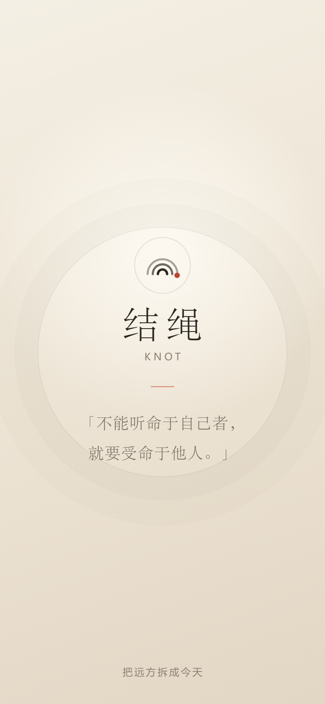
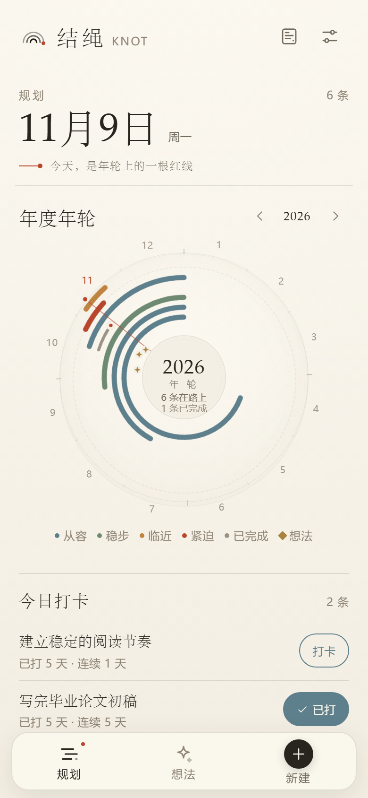
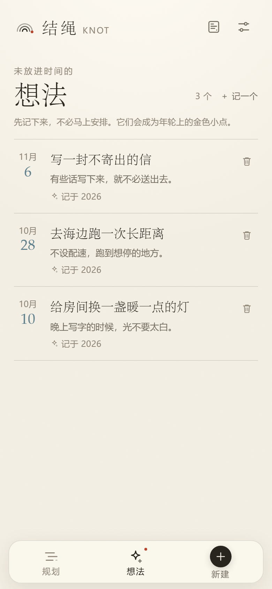
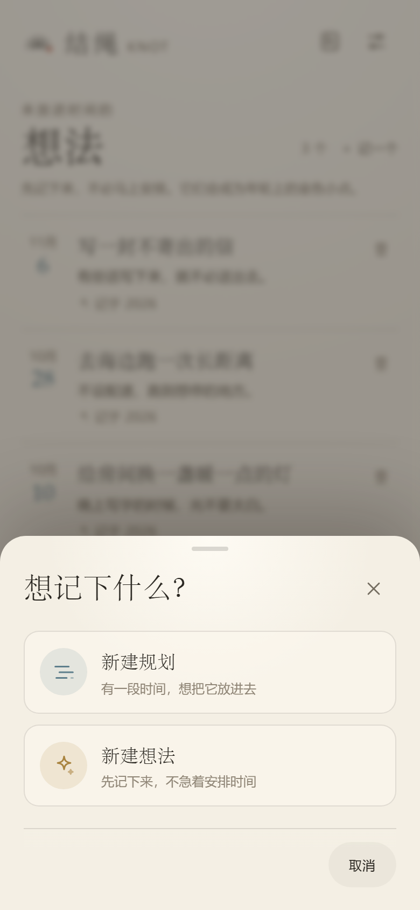
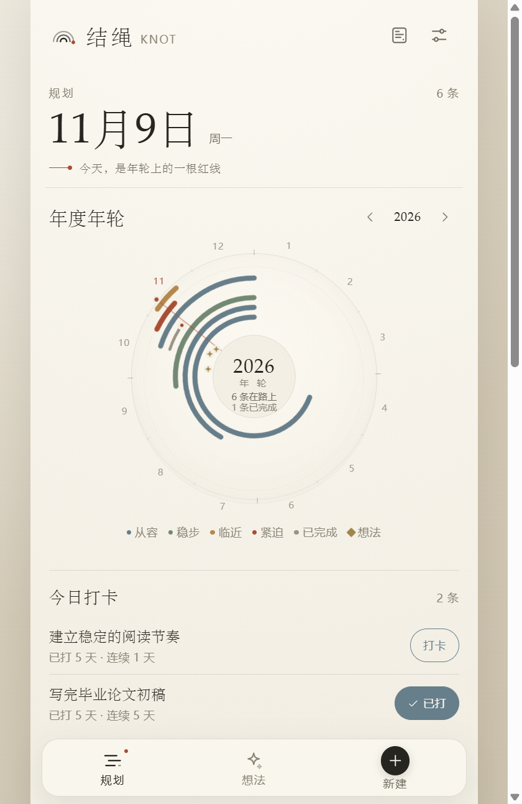
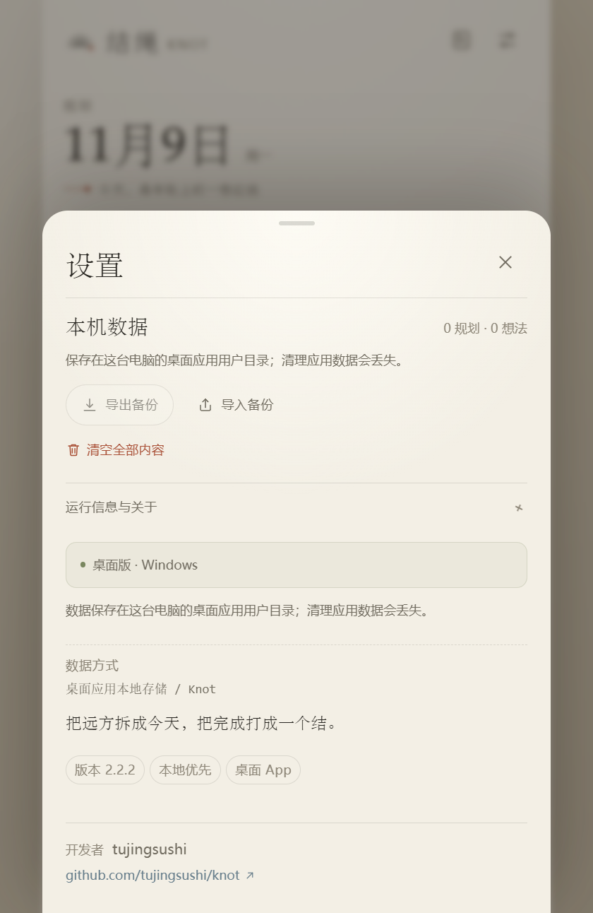

# 结绳 KNOT 2.2.2 · 把远方拆成今天

开发者：**tujingsushi**  
仓库：[github.com/tujingsushi/knot](https://github.com/tujingsushi/knot)

**结绳**是一个本地优先的规划应用：用年度年轮、单条时间轴、子目标、每日打卡和「想法」页，把想做的事放回真实的时间里。

应用原名「三程」，2.0.0 起更名为「结绳」，英文名为 **KNOT**。2.1.0 把原来的总览页和规划页合并成一个「规划」页：日期、年轮、今日打卡、筛选和时间轴都在同一页。2.2.0 新增「想法」页：不急着安排时间的事可以先记下来，并以金色小点出现在年轮上。2.2.1 让已完成的规划也留在年轮上，以灰色细弧和完成结呈现。名字来自「结绳记事」，也对应应用里的完成打结、今天红线和每一次打卡。启动时只显示一页随机名言。









## 开发者信息

- 开发者：**tujingsushi**
- 仓库：<https://github.com/tujingsushi/knot>
- 设置页底部会显示开发者和可点击的仓库地址
- `package.json`、网页 `author` 元信息和 Android `strings.xml` 都写入了开发者信息




## 交付物

| 文件 | 说明 |
|---|---|
| [`release/knot-2.2.2.apk`](release/knot-2.2.2.apk) | 已签名 Release APK，约 3.5 MB，Android 7.0+ |
| [`release/knot-web-2.2.2.zip`](release/knot-web-2.2.2.zip) | 可部署到 HTTPS 的 PWA 构建包 |
| [`release-desktop/knot-desktop-2.2.2-portable.exe`](release-desktop/knot-desktop-2.2.2-portable.exe) | Windows x64 单文件便携版 |
| [`release-desktop/knot-desktop-2.2.2-x64.zip`](release-desktop/knot-desktop-2.2.2-x64.zip) | Windows x64 解压版 |
| [`DESKTOP.md`](DESKTOP.md) | 桌面版安装、数据与构建说明 |
| [`APK-INSTALL.md`](APK-INSTALL.md) | HarmonyOS 7 / 卓易通安装说明与风险 |
| [`screenshots/`](screenshots/) | 开屏、规划、想法、桌面版、详情、今日一页等截图 |

APK 校验信息：

```text
应用名：结绳
包名：com.sancheng.app
版本：2.2.2 (versionCode 18)
compileSdk：36
targetSdk：34
minSdk：24
签名：v2，CN=SanCheng
大小：3,520,114 字节
SHA-256：3EF3A0F38990C6D5E599E1B557341F34C1D358ADD4C4A1F02AA37FA075C5C8EA
```

> **重要：** HarmonyOS 7 是纯血鸿蒙，系统本身不能安装 Android APK。这个 APK 只能通过 **卓易通等 Android 兼容层**运行，不是鸿蒙原生 HAP。兼容层是否支持该 APK，必须在你手机上实际验证。

## 桌面版

Windows x64 桌面版基于 Electron 45，与 Web 版共用同一份界面和数据模型。

- 便携版：`release-desktop/knot-desktop-2.2.2-portable.exe`，110,641,064 字节
- 解压版：`release-desktop/knot-desktop-2.2.2-x64.zip`，153,598,175 字节
- 便携版 SHA-256：`02B74E764A558B6A3A62A0ACB3AA37849CBAF106091358EC395960214C40C08E`
- 解压版 SHA-256：`D045EDA48C651BF360504C7690BB1F00E539A964405E9E79195D5AFEA7E176D1`
- 详细说明见 [DESKTOP.md](DESKTOP.md)

`knot.exe` 是兼容启动器，会启动同目录的 `knot-core.exe --no-sandbox`，用于兼容 Chromium 沙箱受限的 Windows。便携版数据在同目录 `KnotData`，解压版在 `%APPDATA%\Knot`。未做代码签名，SmartScreen 可能提示未知发布者。



## 更名说明

- 桌面图标名称、应用内字标、PWA 名称、今日一页水印都改为「结绳」
- 英文副标和英文名改为 `KNOT`
- **包名仍是 `com.sancheng.app`**，没有更换
- 存储键、原生数据文件名和备份里的 `app: "sancheng"` 保留，用于兼容旧数据
- 想法使用独立的 `sancheng.ideas.v1` 键，并一起写入原生快照和 JSON 备份
- 因此从「三程」1.3.x 可以直接覆盖升级，规划、子目标、打卡记录都会保留

如果未来改成全新包名，旧 App 无法直接覆盖，需要先导出 JSON，再在新包导入。

## 开屏名言

每次冷启动会从四句名言中随机选一句显示：

1. 不能听命于自己者，就要受命于他人。
2. 每一个不曾起舞的日子，都是对生命的辜负。
3. 对未来真正的慷慨，是把一切献给现在。
4. 对待生命你不妨大胆冒险一点，因为好歹你要失去它。

开屏约 3 秒，轻触可提前进入。名言只用于本地展示，不联网、不统计。

启动时只显示这一页：

- 已移除 Android 启动画面的应用图标（改为透明图标 + 纸色背景）
- 已移除 HTML 启动占位里的「结绳」名称页
- 冷启动从第一帧内容开始就是名言页
- 某些系统在 WebView 加载前仍会有极短的纸色空白帧，但不会再出现图标页或名称页

## 2.2.2 开发者信息与桌面版

- 设置页底部新增「开发者 tujingsushi」
- 新增可点击的仓库地址 `github.com/tujingsushi/knot`
- 网页、PWA 和 Android 包内补充开发者元信息
- 新增 Electron Windows 桌面版：便携 exe、解压 zip
- 桌面版识别自己的运行环境，隐藏浏览器安装引导，显示数据说明
- 不改变应用数据、包名和 Android 签名

## 2.2.1 已完成规划留在年轮上

- 年轮现在同时包含「在路上」和「已完成」的规划，已归档的规划仍不画入
- 已完成规划用一条更细、更淡的灰色弧线表示，不再消失
- 完成的位置保留红色小结
- 年轮中心会同时显示在路上和已完成的数量
- 年轮图例新增灰色的「已完成」
- 已完成规划仍可点击弧线进入详情

## 2.2.0 想法页

- 底部导航新增「想法」，底部「新建」会先让你选择新建规划或新建想法
- 想法只有标题、补充和记录日期，不要求安排开始 / 结束时间
- 想法按日期倒序展示，可以点击编辑、也可以删除
- 每个想法会以金色小点出现在对应年份的年轮上
- 年轮图例新增「想法」；同一天有多个想法时，会在同一角度轻微错开
- 想法和规划分开存储，但共用同一份 JSON 备份和原生快照

## 功能

- **单页规划**：日期、年度年轮、今日打卡、状态筛选、时间范围、时间轴合并在一个「规划」页
- **想法页**：记录不急着安排的事，并按日期点缀在年轮上
- 规划：标题、起止日期、备注、子目标、每日打卡、状态
- 年度年轮：只显示在路上的规划，按时间紧迫度变色
- 单条时间轴：3 个月 / 1 年 / 全部
- 规划页默认「在路上」，可切换已完成 / 已归档
- 每条规划的时间条上有一个小小的今天刻度
- 子目标：逐条勾选，最多 10 个
- 每日打卡：
  - 新建 / 编辑时开启
  - 详情页今天打卡、补打卡、取消
  - 最近 14 天记录、总天数、连续天数
  - 规划页「今日打卡」快捷按钮
  - 规划行显示打卡天数
- 完成打结、完成印章
- 今日一页：1080 × 1920 壁纸导出
- 所有可见文字不小于 12px
- 本地优先，无账号、无后端

## 数据保存

### Android APK

- 规划和想法一起写入 App 私有文件：`sancheng-plans.json`
- 上一版备份：`sancheng-plans.backup.json`
- App 退到后台时再写一次
- 设置页显示自动保存状态
- 导出 JSON 会调用系统分享面板
- **卸载 App 或清除应用数据仍会丢失**，请定期导出备份

### Web/PWA

- 规划存储键：`sancheng.plans.v1`
- 想法存储键：`sancheng.ideas.v1`
- 数据只保存在浏览器，不上传服务器
- 清理站点数据、卸载浏览器或换手机会丢失

### 升级

1.0–2.2.2 使用相同的包名和签名密钥，可以直接覆盖安装。

更名不会改变包名，所以「三程」1.3.x 可以直接升级为「结绳」2.2.2，数据保留。

签名密钥必须保留：

- `android/keystore/sancheng-release.jks`
- `android/keystore.properties`

密钥丢失后，新版本无法覆盖旧版本，只能卸载重装，App 数据会一起丢失。

## 安装 APK

完整步骤、风险与排错见 [APK-INSTALL.md](APK-INSTALL.md)。

1. 把 `knot-2.2.2.apk` 传到手机
2. 在文件管理器打开，选择「卓易通」安装
3. 允许安装未知来源应用
4. 打开「结绳」，确认设置页显示「已作为独立 App 运行」
5. 新建一条带子目标和打卡的测试规划，退出重进，确认数据仍在

如果卓易通拒绝安装，说明兼容层不支持这个 Android 包；APK 路线在 HarmonyOS 7 上没有备选方案，只能改用 PWA 或原生鸿蒙 HAP。

## 本地运行

要求 Node.js >= 20.19。

```bash
npm install
npm run dev
```

生产构建：

```bash
npm run build
python -m http.server 4173 --directory dist
```

## 构建桌面版

环境要求：Windows x64、Node.js >= 20.19。首次安装依赖会下载 Electron。

```bash
npm install
npm run desktop:dev       # 构建 dist 并启动 Electron
npm run desktop:pack      # release-desktop/knot-desktop-2.2.2-x64.zip
npm run desktop:portable  # release-desktop/knot-desktop-2.2.2-portable.exe
```

桌面主进程在 `desktop/main.cjs`，窗口 560 × 860；便携版数据在同目录 `KnotData`，解压版在 `%APPDATA%\Knot`。详见 [DESKTOP.md](DESKTOP.md)。

## 构建 Android APK

环境要求：

- JDK 21
- Android SDK Platform 36
- Build Tools 36.0.0
- Gradle 8.14.3

```bash
npm run build
npx cap sync android
cd android
gradlew.bat assembleRelease
```

签名信息从 `android/keystore.properties` 读取。`targetSdk` 故意设为 34，避免 Android 15+ 在兼容层强制 edge-to-edge 导致状态栏遮挡；`compileSdk` 仍为 36。

当前工作区有一套本地工具链在 `.tooling/`（已忽略）。普通开发机安装 Android Studio 后可直接打开 `android/`。

## 测试

Web 自动化检查：

```bash
node scripts/functional-check.mjs
```

覆盖开屏名言、新建想法、想法编辑、年轮想法标记、已完成规划年轮显示、开发者信息、新增、子目标、每日打卡、规划页快捷打卡、持久化、完成、重开、归档、删除、JSON 导出/导入、清空、manifest、Service Worker 与离线重载，共 31 项，全部通过。

APK 已完成：

- `assembleRelease` 构建成功
- `apksigner verify` 通过（v2）
- 应用名「结绳」、英文名 KNOT、版本 2.2.2、包名、启动 Activity、min/target SDK 检查通过
- APK 内 Web 资源、Capacitor 原生桥接代码、JSON 文件备份代码检查通过
- 320px / 390px 视觉回归通过；所有可见文字 ≥ 12px

桌面版已完成：

- Electron 45.2.3 开发模式启动正常
- 打包后的 `knot.exe` 启动正常
- 便携版直接双击启动正常（不附加命令行参数）
- 解压版 `knot.exe` 直接启动正常
- 桌面桥识别 Windows / Electron 版本
- 设置页显示桌面版、数据说明和开发者信息
- zip 与 portable 构建成功
- 桌面包内 `app.asar` 只包含 `dist`、`desktop` 和元数据
- 启动器使用 `--no-sandbox` 兼容受限 Windows；只加载本地内容
- 未做代码签名，SmartScreen 可能提示未知发布者

**未完成：** 没有在 HarmonyOS 7 + 卓易通真机上安装运行；这需要你在手机上完成首次侧载验证。

## 主要目录

```text
src/                       Web 应用
desktop/                   Electron 主进程、预加载桥与图标
android/                   Capacitor Android 工程
android/keystore/          APK 更新签名密钥
public/                    PWA manifest、Service Worker、网页图标
scripts/                   图标生成与自动化测试
dist/                      Web 生产构建
release/                   APK 与 PWA 交付包
release-desktop/           Windows 桌面版 zip / portable
screenshots/               界面截图
```

## 设计说明

- **结绳记事**：完成不是消失，而是在时间上留下一个结。
- **今天是一根红线**：年轮里的径向红线，规划时间条上的小刻度。
- **颜色是时间的温度**：越接近结束，颜色越暖；完成任务退成灰色。
- **一页把时间、打卡和规划放在一起**：不再在总览和规划之间切换。
- **子目标与打卡**：把远方拆成今天可以完成的一小步。
- **时间是主角**：不展示虚假的完成百分比，只呈现真实的时间位置。

## 技术栈

React 19 + TypeScript + Vite 7 + Capacitor 8 + Electron 45，无 UI 组件库、无图表库、无后端。年轮与时间轴均由 SVG / CSS 手绘实现。

版本：2.2.2
